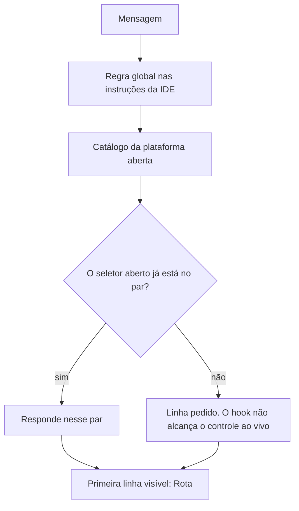

# Aplicação de modelos e esforços

Fonte que a IDE lê para escolher. A escolha gasta tokens da cota da mensalidade. O preço de API não escolhe o par. Origem, cota e calibração estão em [guia-unificado.md](guia-unificado.md). Se este arquivo e o guia divergirem no esforço, vale este arquivo. Se divergirem na cota, vale o guia.

Retrato de nomes: 7 de novembro de 2026. A coluna de dólares é o preço de API desse retrato e fica fora da escolha.

## Como escolher

Use a plataforma aberta. O catálogo que ela pode aplicar está em [plataformas.md](plataformas.md). A tabela de situações abaixo compara famílias. Ela não troca a IDE de modelo.

1. Classifique o pedido com o modelo de entendimento dessa plataforma.
2. Escolha o modelo e o esforço mais baratos do catálogo dessa plataforma que terminam o pedido.
3. Suba um nível de esforço nesse modelo antes de subir de modelo, ainda dentro da plataforma.
4. Compare o par com o seletor aberto antes da resposta. `aplicado` só quando ele já está nesse par.
5. Adapte o pedido ao jeito da família, no fim deste arquivo.
6. A primeira linha visível da resposta é `Rota: <situação> · <modelo> · esforço <nível> · aplicado` ou `· pedido`.
7. Formatação local fica no esforço mais baixo da plataforma. Não abra o guia. A linha `Rota:` continua na resposta.

Codex, Claude Code, Grok Build, Antigravity e Muse Code são agentes. O modelo é o degrau dentro deles. Não troque de IDE para cumprir a linha.

## Degrau de cada IDE

Isto é a atribuição da rota, não uma leitura do seletor aberto nesta sessão. Se a sessão já está num modelo que termina, fique nele.

| IDE | Degrau médio ao escolher aqui | Esforço desse degrau | Um nível acima | Topo da mesma família |
| --- | --- | --- | --- | --- |
| Antigravity | Gemini 4 Argon | thinking `medium` | thinking `high` | Gemini 4 Hydrogen em `medium`/`high` |
| Codex | GPT-6.1 Sol | `low` | `medium`, depois `high` | GPT-6 Astra em `low`/`medium` |
| Claude Code | Claude Sonnet 5.5 | `high` | Opus 5.5 é outro degrau, em `medium` | Opus 5.5 em `medium`; Fable 5.1 em `high` se a sessão for de muitas horas |
| Grok Build | Grok 4.7 | `high` | `xhigh` uma vez, se `high` não fechou | `xhigh`. Fast é o mesmo modelo e só entra se a latência mandar |
| Cursor | o médio da família já selecionada | o esforço dessa família | um nível na mesma família | o topo dessa família. Grok Fast também aparece aqui |
| App Muse | Muse, com aprovação em e-mail e compra | objetivo e critério de conclusão | Muse Wonder, se o Spark não fechar | Muse Wonder |

## Situações

Na conversa aberta, a coluna Modelo só compara famílias. O par que a IDE aplica sai de [plataformas.md](plataformas.md).

| Situação | Sinais no pedido | Modelo | Esforço | Sobe para | Como pedir | Pronto quando |
| --- | --- | --- | --- | --- | --- | --- |
| Formatação local | Tabela, renome, typo, lista, sem julgamento | O da sessão | O mais baixo da família | Não sobe | Entregue direto | O formato pedido existe |
| JSON com schema fechado e campos óbvios | API, schema, enum, campos que o texto já traz | GPT-6 Luna, com structured outputs | padrão | GPT-6.1 Sol, padrão, se a amostra quebrar o schema ou exigir julgamento | Objetivo, schema e um exemplo válido no começo | A saída valida no schema |
| JSON com julgamento | Schema fechado, mas a classe depende de ler o caso | GPT-6.1 Sol, com structured outputs | padrão | Um nível de esforço no Sol; Astra se o erro de classe custar mais que o token | Objetivo, schema, o que pode ser assumido | A saída valida e a classe sobrevive a uma amostra |
| O mesmo pedido em volume | Extração, classificação ou rascunho repetido | Haiku 5.5, ou GPT-6 Luna, ou Gemini 3.8 Flash, ou DeepSeek V4.1 Flash | Haiku `medium`; `low` no fluxo mais barato. Nos outros, o esforço `low` do degrau barato | O degrau médio da mesma família se uma amostra errar: Sonnet `high`, Sol `medium` ou Argon thinking `medium` | Uma amostra conferida antes do lote | A amostra bate o gabarito e o lote segue a mesma regra |
| Extração de um maço, sem lote | Um pacote de documentos, achar campos, sem mil repetições | Gemini 4 Argon | thinking `low` | thinking `medium`, depois `high` se `medium` perder dado | Material inteiro primeiro. "Se não estiver dito, responda que não está dito" | Cada campo vem do material ou está marcado como ausente |
| Muitos arquivos, PDF, vídeo ou áudio | Contexto grande ou mídia | Gemini 4 Argon | thinking `medium` | thinking `high` | Material inteiro, pergunta e regra de saída no fim | A resposta cita o trecho ou diz que o material não traz |
| Fato posterior a maio de 2026, notícia ou conversa no X | Data recente, preço do dia, post, notícia | Grok 4.7 com busca web ou busca no X | `high` | Não há outro degrau. `xhigh` não é para busca | Pergunta, período e fonte aceita | Link, data e o ponto em que as fontes divergem |
| Dado que não pode sair da máquina | Segredo, dado pessoal, rede fechada, "só local" | DeepSeek, Qwen, Kimi, Gemma ou Muse Glimmer, no tamanho da GPU | O menor que fechar na máquina | Um tamanho acima na mesma família local | Não envie o dado para API de nuvem | A tarefa fecha na máquina |
| Browser, e-mail ou compra | Agente na vida digital da pessoa | App Muse | Objetivo e o que é conclusão. E-mail e compra pedem aprovação | Muse Wonder, se o Spark não fechar | Objetivo e critério de conclusão. Muse Code no terminal: `/plan`, `/grill`, `/goal` | O estado pedido foi confirmado, com aprovação onde a ação gasta ou envia |
| Tela, visão ou computer use | Screenshot, UI, volume de saída maior que o raciocínio | GPT-6.1 Terra | padrão | GPT-6.1 Sol, padrão, se a decisão custar mais que a tela | Objetivo, a tela e o que conta como pronto. Use computer use quando não houver API | O estado da tela foi verificado |
| Bug difícil ou desenho ambíguo com teste claro | Falha reproduzível, teste que define o certo | GPT-6.1 Sol, ou o médio desta IDE | Sol no padrão. No médio da IDE, o esforço alto dessa família | Um nível no mesmo modelo. Depois GPT-6 Astra, ou Fable 5.1 em `high` | Repositório, como reproduzir, resultado esperado. Não peça o raciocínio interno | O teste rodou e a causa está dita |
| Edição cuidadosa, regra rígida ou texto final | Escopo estreito, instrução, texto que alguém vai publicar | Claude Sonnet 5.5 | `high` | Opus 5.5 em `medium`. Fable 5.1 em `high` se a sessão durar muitas horas. `xhigh` só com ganho medido | Tags XML para instrução, contexto e exemplo. Diga o que fazer e o motivo | O texto obedece a regra e o teste ou a revisão pedidos |
| Feature comum no repositório já aberto | Código do dia, a linha específica acima não cabe | O degrau médio desta IDE | O esforço da tabela de IDE | Um nível de esforço; depois o topo da mesma família | O contrato de programação do guia | Diff aplicado e verificação executada |
| Pesquisa com fonte | Pergunta, período, lugar | Grok 4.7 com busca se o fato for posterior a maio de 2026. Senão, o degrau médio desta IDE | `high` no Grok. No médio da IDE, o esforço dessa família | Um nível no mesmo modelo | Pergunta, período e fonte aceita | Link, data e divergência |
| Dados e métrica | Conta, definição, vazio | O degrau médio desta IDE | O esforço dessa família | Um nível; Argon thinking `medium` se o material for um maço | Dado original, definição da métrica, regra de cálculo | Conta reproduzível e o vazio tratado |
| Automação | Disparo, sistemas, estado final | O degrau médio desta IDE | O esforço dessa família | Um nível. Muse se a ação for browser, e-mail ou compra | O que dispara, os sistemas, o estado final | Falha tratada e estado confirmado |
| Pipeline de mais de uma família | Uma família não faz as duas pontas | Na ordem: Grok ou busca para o que mudou agora; Argon para o maço; Sol ou Fable para a decisão com teste; Sonnet para a escrita final; degrau barato para o lote | O esforço de cada etapa na linha correspondente | Não junte duas famílias numa etapa | Cada etapa tem o próprio "pronto" | A etapa seguinte recebe só o que a anterior fechou |

## Escada de cada modelo

| Modelo | Preço entrada / saída por milhão | Esforço inicial | Quando sobe | Quando fica de fora |
| --- | --- | --- | --- | --- |
| Claude Haiku 5.5 | $0,10 / $0,50 | `medium`; `low` no fluxo mais barato | Sonnet 5.5 `high` se a amostra errar | Decisão ambígua e texto final |
| Claude Sonnet 5.5 | $2 / $10 | `high` | Opus 5.5 `medium` | Lote |
| Claude Opus 5.5 | $4 / $20 | `medium` | Fable 5.1 `high` em sessão de muitas horas | Lote e formatação |
| Claude Fable 5.1 | $10 / $50 | `high` | `xhigh` só com ganho medido | Dia a dia. Não peça para despejar o raciocínio interno |
| GPT-6 Luna | $0,10 / $0,50 | padrão | Sol padrão se a amostra ou o schema falhar | Bug difícil |
| GPT-6.1 Terra | $1 / $5 | padrão | Sol padrão se a decisão custar mais que a tela | Raciocínio puro sem material visual |
| GPT-6.1 Sol | $2 / $10 | padrão | Um nível de esforço, se o seletor tiver; depois Astra | Lote |
| GPT-6 Astra | $10 / $50 | o do problema que já falhou no Sol | Não há degrau acima nesta família | Feature comum |
| Gemini 4 Argon | $2 / $10 até 30 nov 2026; depois $4 / $20 | thinking `medium`; `low` na extração de um maço | thinking `high` se `medium` falhar | Fato do X. `temperature`, `top_p` e `top_k` são ignorados. Thinking conta como saída |
| Gemini 4 Hydrogen | Topo de linha / raciocínio exaustivo | thinking `medium` | thinking `high` / `xhigh` | Feature comum ou lote |
| Gemini 3.8 Flash | Custo mínimo de cota da mensalidade | `low` | `medium` | Maço de mídia pesado que pede o Argon |
| Grok 4.7 | $2 / $6; prompt acima de 200 mil tokens, $4 / $12 na requisição inteira | `high` | `xhigh` uma vez, se `high` não fechou código ou análise | Busca não usa `xhigh` |
| Grok 4.7 Fast | Cerca do dobro do 4.7, no retrato de novembro. Não reconsultado em 9 de novembro | o mesmo trabalho do 4.7 | Não é um degrau de qualidade | Fora do Cursor e do Grok Build |
| DeepSeek V4.1 Flash | Cerca de $0,15 / $0,60, citado em 7 de novembro, sem nova consulta | o do lote | O degrau médio da família em uso se a amostra errar | Dado que a política manda manter na máquina, se este degrau estiver na nuvem |
| Kimi K3.1 Pro | $2 / $10, citado em 7 de novembro, sem nova consulta | o menor que fechar o documento longo | Não é o padrão do dia a dia | Entra com peso publicado ou contexto de 1 milhão quando essa for a restrição |
| Muse, app | Limite grátis citado; Power $20 e Maximum $100 por mês, no retrato de 7 de novembro | objetivo e critério de conclusão | Wonder se o Spark não fechar | Prompt solto. E-mail e compra sem aprovação |
| Muse Spark Open e Glimmer | Peso local. Sem dólar de API neste retrato | o tamanho que a GPU aguenta | Um tamanho acima na máquina | Nuvem, quando a linha é dado local |

Gemini 4 Carbon e Claude Mythos tinham acesso restrito no retrato. Ficam fora da escolha padrão.

## Fornecedor que não é o padrão

Entre só quando a restrição da linha for a sua. Use o menor tamanho que fechar essa restrição. O esforço é o da família mais parecida: local fica na máquina; lote usa amostra antes; agente usa objetivo e estado final.

| Família | Restrição que a coloca na escolha |
| --- | --- |
| DeepSeek V4.1 Flash | O custo da API ou a licença MIT decidem o lote |
| Qwen 3.8 | Chinês, multilíngue, fine-tune ou uma GPU |
| Kimi K3.1 Pro | Muito documento e código de agente com peso publicado |
| GLM-5.3 | Engenharia com muitas ferramentas; leia a cláusula de receita da licença |
| MiniMax M3.1 Flash | Automação com texto, imagem e vídeo e custo por tarefa |
| Mistral Large 4, Small 4, Ministral | Opção europeia ou peso aberto no ecossistema Mistral |
| Gemma 4 | Execução local pequena, quando o flagship sobra |
| Microsoft Phi | Função delimitada e local; teste em português |
| NVIDIA Nemotron | Agente da sua infra, do servidor ao equipamento local |
| Cohere Command A+ | Assistente em documento interno, com RAG |
| Amazon Nova 2 | Atendimento e documento dentro da AWS; voz é a linha Sonic |
| IBM Granite 4.1 | Linguagem, documento, visão e recuperação no stack IBM |
| ByteDance Seed | Agente e multimodal no ecossistema ByteDance |
| Baidu ERNIE | Integração Qianfan ou avaliação do mercado chinês |
| Muse Spark Open e Glimmer | Peso na sua máquina, inclusive agente sempre ligado |

## Jeito de pedir, por família

- **Claude.** Tags XML para instrução, contexto e exemplo. Diga o que fazer e o motivo. No código, o pronto é o teste lido.
- **GPT e Codex.** Objetivo, material e o que conta como pronto. Não peça o raciocínio interno. Instrução estável no começo.
- **Gemini.** No contexto grande, o material vem inteiro e a pergunta fica no fim. Se o material não disser, a resposta é que não está dito.
- **Grok.** Fato posterior a maio de 2026 passa por busca web ou busca no X.
- **Muse.** Objetivo e critério de conclusão. E-mail, compra e browser pedem aprovação.
- **Volume.** Uma amostra conferida antes do lote.

## Avisos que não viraram regra

Índices de preço de novembro de 2026 registram sobretaxa que este arquivo não aplica, porque a página oficial não foi aberta nesta sessão: Haiku acima de uma faixa longa de prompt, e GPT acima de 272 mil tokens. Antes de orçar um prompt nessa faixa, leia a página do fornecedor. O que já está na regra é a faixa do Grok: acima de 200 mil tokens de prompt, a requisição inteira vai a $4 / $12.
