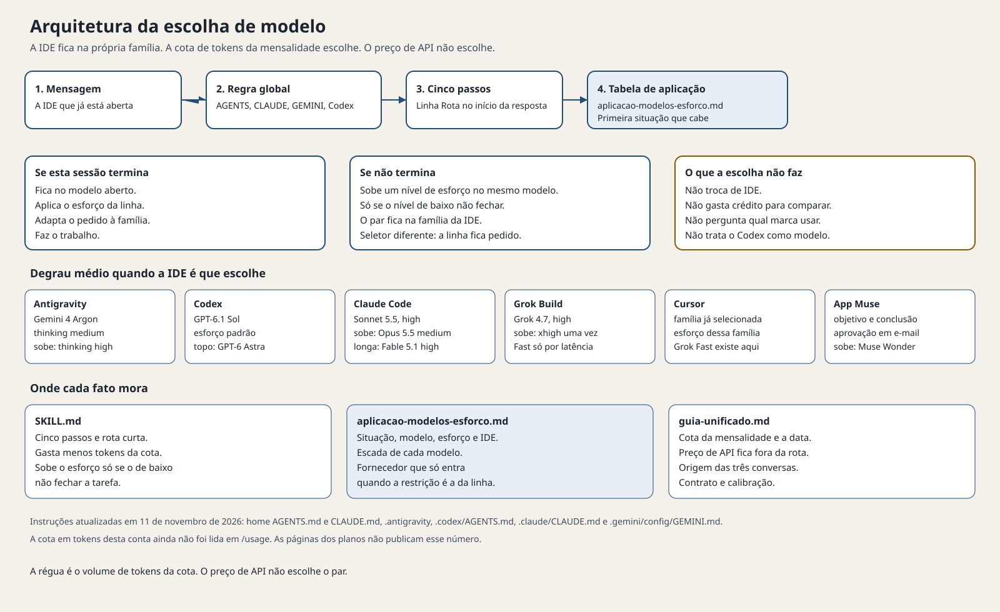
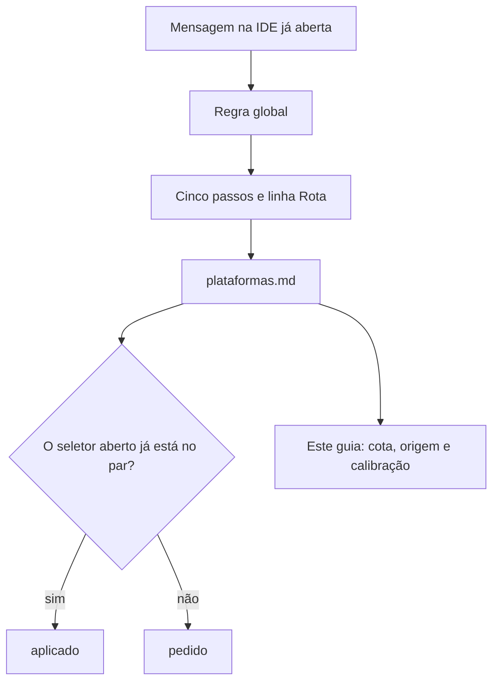

# Guia unificado — qual modelo usar

Retrato de 7 de novembro de 2026, unificado em 8 de novembro de 2026, com a conferência de preço de 9 de novembro de 2026. Este arquivo guarda preço, origem e calibração. Modelo, esforço e o degrau de cada IDE estão em [aplicacao-modelos-esforco.md](aplicacao-modelos-esforco.md). A skill `escolha-de-modelo` aplica a rota; as instruções globais disparam a checagem em toda mensagem.

Nenhum dos três agentes salvou um arquivo. O material de cada um é a resposta da conversa.

## De onde veio

| Origem | Quando | Onde está |
| --- | --- | --- |
| Codex, sessão `01a1b71d-43cc-7623-b845-ad09aa19e426` | 7 nov 2026, 17:46 UTC | `C:\Users\bmart\.codex\sessions\2026\11\07\rollout-2026-11-07T14-45-10-01a1b71d-43cc-7623-b845-ad09aa19e426.jsonl` |
| Grok 4.7, sessão `01a1b71d-3779-79b0-afb6-c9db460cbc19` | 7 nov 2026, 17:46 UTC | `C:\Users\bmart\.grok\sessions\C%3A%5CUsers%5Cbmart\01a1b71d-3779-79b0-afb6-c9db460cbc19\chat_history.jsonl` |
| Antigravity, Gemini 4 Argon (Medium), conversa `28db4fa8-4ffe-4407-8bd5-f7fbc89b3b61`, título "Guia De Uso Dos LLMs" | 7 nov 2026, 15:13 em São Paulo | `C:\Users\bmart\.gemini\antigravity-cli\brain\28db4fa8-4ffe-4407-8bd5-f7fbc89b3b61` |

O pedido foi o mesmo nos três: usar melhor cada grande LLM do mercado, incluindo Gemini, Anthropic, Grok, Muse e Codex.

## O que cada conversa entrega

| | Antigravity | Codex | Grok |
| --- | --- | --- | --- |
| Forma | Mapa de uma página e truque de prompt por família | Mapa largo de fornecedores e um pedido-modelo por tipo de trabalho | Preço, esforço e a superfície (IDE ou app) em que abrir a tarefa |
| Base | Resumos de busca. Os links guardados são redirecionamentos | Documentação oficial citada, com ressalva de acesso restrito | Documentação oficial e preço de lista por milhão de tokens |
| Força que ficou neste guia | Pipeline opcional e o jeito de pedir em cada família | Distinção entre fornecedor, modelo e agente; lista para comparar quando o caso pede; método de avaliação | Régua de custo: subir esforço antes de trocar de família |
| O que não entrou como regra | Tratar Codex como se fosse um modelo. Faixa de preço "$8 a $20+". Encerrar perguntando em qual uso aprofundar | A lista inteira de fornecedores como padrão do dia a dia. Preço, que o Codex não fixou | A lista menor de "outros do mercado", substituída pela lista mais larga do Codex |

Os três concordam no núcleo: não existe um modelo melhor para tudo. O ganho está em casar a tarefa com a família, com o degrau dentro dela e com o nível de esforço.

## Como o sistema roda em toda mensagem

Vale para Antigravity, Codex, Grok, Claude Code e qualquer outra IDE de IA que carregue a skill ou a regra global.

1. Identifique a plataforma aberta e leia [plataformas.md](plataformas.md).
2. Classifique o pedido com o modelo de entendimento dessa plataforma.
3. Escolha o par desse catálogo que termina o pedido gastando menos tokens da cota da mensalidade. Suba um nível de esforço antes de subir de modelo, dentro da mesma família, só quando o esforço de baixo não fecha.
4. `aplicado` quando o seletor aberto já está nesse par. `pedido` quando o hook não troca o seletor.
5. Adapte o pedido à família da plataforma aberta.

A IDE aberta só aplica um modelo da própria família. A primeira linha visível é `Rota: <situação> · <modelo> · esforço <nível> · aplicado`, ou `· pedido`. No Grok, `aplicar-plataforma.py` roda em `UserPromptSubmit`. Se o par diverge, o prompt não segue. `model-route-stop.py` devolve a resposta sem a linha `Rota:`. A tabela de situações compara famílias e não troca a IDE.

Codex, Claude Code, Grok Build, Antigravity e Muse Code são agentes. GPT, Claude, Gemini, Grok e Muse são famílias de modelo. Escolher o agente sem escolher o degrau gasta a cota em trabalho que um esforço menor fecharia.

## Arquitetura



A mensagem entra pela IDE já aberta. A regra global dispara a skill. A skill lê [plataformas.md](plataformas.md) e escolhe um par dessa família. `aplicado` significa que o seletor aberto já está nesse par. Este guia entra para a cota da mensalidade, a origem e a calibração. O preço de API fica registrado e não escolhe o par. A tabela longa compara famílias e não troca a IDE.



| Peça | Função |
| --- | --- |
| Instruções globais | Disparam a skill em toda mensagem |
| `SKILL.md` | Cinco passos e rota curta |
| `aplicacao-modelos-esforco.md` | Situação, modelo, esforço e degrau de cada IDE |
| Este guia | Cota da mensalidade, origem, contrato de pedido e calibração. O preço de API não escolhe |
| Antigravity | Gemini 4 Argon (`medium` -> `high`) ou Gemini 4 Hydrogen (`medium` -> `xhigh`) para o topo; Gemini 3.8 Flash (`low`) para entrada/lote |
| Codex | GPT-6.1 Sol (`low` -> `high`), topo GPT-6 Astra; GPT-6 Luna para lote |
| Claude Code | Sonnet 5.5 em high; Opus 5.5 em medium; Fable 5.1 em high numa sessão longa |
| Grok Build | Grok 4.7 em high; xhigh uma vez se high não fechou; grok-4.7-build-fast para latência |
| Cursor | Família já selecionada; Grok Fast existe aqui |
| App Muse | Objetivo e conclusão, com aprovação; Wonder se o Spark não fechar |

## Rota padrão

Essa tabela compara famílias. Na conversa, o par sai de [plataformas.md](plataformas.md) e fica na família da IDE aberta.

| Pedido | Primeiro | Suba para | Por quê este degrau |
| --- | --- | --- | --- |
| Trabalho comum no repositório já aberto | O degrau médio desta IDE | Um nível de esforço; depois o topo da mesma família | Trocar de IDE no meio custa mais do que o token |
| Edição cuidadosa, regra rígida, texto final | Claude Sonnet 5.5 | Opus 5.5; Fable 5.1 se a sessão durar muitas horas | Claude segura escopo e soa menos robótico |
| Bug difícil ou desenho ambíguo com teste claro | GPT-6.1 Sol, ou o médio desta IDE em esforço alto | GPT-6 Astra ou Fable 5.1 | O contrato é o teste, não o caminho do raciocínio |
| Muitos arquivos, PDFs, vídeo ou áudio | Gemini 4 Argon, thinking medium | thinking high | A janela grande só rende se o material for inteiro |
| Fato recente, notícia ou conversa no X | Grok 4.7 com busca web ou busca no X | — | O corte de conhecimento citado é maio de 2026 |
| Extração, classificação ou o mesmo pedido em volume | Haiku 5.5, GPT-6 Luna, Gemini 3.8 Flash ou DeepSeek V4.1 Flash | O degrau médio, se uma amostra no degrau baixo errar | O topo gasta muito mais da mesma cota por tarefa |
| Dado que não pode sair da máquina | DeepSeek, Qwen, Kimi, Gemma ou Muse Glimmer, no tamanho da GPU | — | Aberto não é grátis: pese GPU, licença e tarefa concluída |
| Agente pessoal com browser, e-mail ou compra | App Muse, com aprovação | Muse Wonder se o Spark não fechar | Aqui a permissão importa mais do que o prompt |
| JSON de API com schema fechado | GPT com structured outputs, Luna ou Sol | — | O schema garantido evita quebrar a tipagem |

Pipeline, só quando uma família não faz as duas pontas: Grok ou busca para o que mudou agora, Gemini para o maço de arquivos, o modelo de raciocínio para a decisão com teste, Claude para a escrita ou a edição final, e o degrau barato para o lote.

## Como pedir em qualquer família

Um pedido que fecha tem, nesta ordem:

1. **Resultado.** O que tem de existir no fim.
2. **Público.** Quem lê, em que tom e formato.
3. **Contexto.** Arquivos, erro, trechos. Material longo vem antes da pergunta.
4. **Decisão.** O que pode ser assumido e o que precisa de pergunta.
5. **Pronto.** Teste rodou, fonte citada, ou nada inventado além do material.

```text
Objetivo: <o que deve existir no fim>
Público: <quem lê e em que formato>
Contexto: <arquivos, erro, links. O material longo vem antes>
Pode decidir sozinho: <escolhas de implementação>
Precisa perguntar antes: <escopo, dado externo, ação irreversível>
Pronto quando: <teste rodou / fonte citada / nada além do material>
Se faltar dado no material, diga que não está dito.
```

| Trabalho | O que entregar no pedido | O que cobrar na resposta |
| --- | --- | --- |
| Escrita | Público, oferta, prova e um exemplo da sua voz | Afirmação sustentada e o texto no formato pedido |
| Pesquisa | Pergunta, período, lugar e fonte aceita | Link, data e o ponto em que as fontes divergem |
| Programação | Repositório, como reproduzir, resultado esperado | Diff aplicado, verificação executada, causa |
| Dados | Dado original, definição da métrica, regra de cálculo | Conta reproduzível e o tratamento do vazio |
| Automação | O que dispara, os sistemas, o estado final | Falha tratada e o estado confirmado |

### Ajuste por família

- **Claude.** Tags XML para instrução, contexto e exemplo. Diga o que fazer e o motivo. "Escreva por extenso porque isto vai para leitor de tela" funciona melhor do que uma lista de proibições. Em documento longo, peça o trecho que sustenta a conclusão antes da conclusão. No Fable, não peça para despejar o raciocínio interno. No código, o pronto é o teste lido e o erro corrigido.
- **GPT e Codex.** Objetivo, material e critério de pronto. Não peça "pense passo a passo": o esforço já é interno. Instrução estável no começo, para o cache. Corrija a tarefa no meio em vez de recomeçar. Use computer use quando não houver API. Sol no esforço padrão para feature; Terra quando a tela ou o volume de saída dominam a tarefa; Astra quando o Sol não fechou.
- **Gemini.** Regras primeiro no prompt curto. No contexto gigante, o material vem inteiro e a pergunta fica no fim. Inclua "se o material não disser, responda que não está dito". No Argon, `temperature`, `top_p` e `top_k` são ignorados. Thinking `low` para extração, `medium` para código e agente, `high` para o que falhou em `medium`.
- **Grok.** Fato posterior a maio de 2026 passa por busca. `high` para código e análise, porque o `low` que não fecha repete o prompt inteiro na cota. `xhigh` só para o bug que `high` não fechou. A variante Fast é o mesmo modelo mais rápido e só entra se o pedido pede latência. No retrato de novembro ela aparece no Cursor e no Grok Build.
- **Muse.** Dê um objetivo e o que é conclusão, não uma pergunta solta. O app age na vida digital, com browser e apps; e-mail e compra pedem aprovação. Muse Code usa `/plan`, `/grill` e `/goal` no terminal. Spark Open e Glimmer são a via local.
- **Volume.** Classifique, extraia ou rascunhe no degrau barato. Confira uma amostra antes do lote.

## Cota da mensalidade

A escolha gasta o volume de tokens da cota que a mensalidade já inclui. O preço de API por milhão de tokens não escolhe o modelo nem o esforço.

Entra na conta o que a tarefa pronta consumiu: entrada, raciocínio e saída, mais o retrabalho se o degrau de baixo não fechou. Um esforço mais alto gasta mais tokens de raciocínio da mesma cota. Subir de modelo, dentro da mesma plataforma, só quando esse esforço extra ainda não fecha.

A mensalidade compra a cota. A janela em que ela acaba é a que o plano publica. Em vários planos essa janela é a semana, ou cinco horas com um teto semanal, e não o mês calendário.

| Plataforma | O que a página do plano publica | Lido em |
| --- | --- | --- |
| Grok, The X Subscription | Uma cota semanal compartilhada entre Grok e Cursor, só uso de primeira parte. Plus é a base. Premium é 4x, Super 15x, Ultra 50x. O tamanho em tokens não está na página. A barra viva é Settings ou `/usage`. | [x.ai/pricing](https://x.ai/pricing) e [usage limits](https://docs.x.ai/x-subscription/usage-limits), 11 nov 2026 |
| Codex e ChatGPT | A página estima mensagens locais por janela de 5 horas. O intervalo muda com o modelo e o tamanho da tarefa. A partir de dezembro de 2026 a cota de Plus, Pro e Business passa a ser compartilhada e contada em tokens. O total em tokens não está publicado. | Índices que citam a página da OpenAI, 9 a 11 nov 2026. A página oficial não foi aberta nesta sessão |
| Claude | Pro tem janela de 5 horas e limite semanal, os dois sobre todos os modelos. Max é 5x o Pro nas duas janelas. Ultra é 10x o Pro na semana. Não há número de tokens. Mensagem longa, arquivo e modelo mais pesado gastam mais da mesma cota. | Índices que citam support.claude.com, 10 nov 2026. A página oficial não foi aberta nesta sessão |
| Antigravity | A cota acompanha o trabalho do agente. Sem Pro ou Ultra, refresca na semana. Pro refresca a cada 5 horas até o limite semanal. Ultra tem a cota e o limite semanal mais altos. Não há número de tokens. | Índices que citam a documentação do Antigravity, 10 nov 2026. A página oficial não foi aberta nesta sessão |

Nesta máquina, `grok usage` sem id de sessão, em 11 de novembro de 2026, terminou com código 1. A mensagem pede para ler o plano em `/usage` dentro do Grok. O número absoluto da cota não foi inventado.

## Preço de API, fora da rota

Dólares por milhão de tokens, entrada / saída. Esta tabela não escolhe o modelo. Em 9 de novembro de 2026, índices que citam a página oficial repetiram os valores de Claude, GPT-6, Gemini 4 Argon e Grok 4.7 deste retrato. DeepSeek, Kimi e a assinatura do app Muse não foram reconsultados. Argon segue em preço de introdução até 30 de novembro de 2026; a documentação do modelo cita $4 / $20 a partir de 1º de dezembro, e conta o thinking como token de saída. A coluna de dólares em [aplicacao-modelos-esforco.md](aplicacao-modelos-esforco.md) repete esta tabela e também não escolhe o par.

| Modelo | Entrada / saída | Esforço inicial citado |
| --- | --- | --- |
| Claude Fable 5.1 | $10 / $50 | `high`; `xhigh` só com ganho medido |
| Claude Opus 5.5 | $4 / $20 | `medium` |
| Claude Sonnet 5.5 | $2 / $10 | `high` |
| Claude Haiku 5.5 | $0,10 / $0,50 | `medium`; `low` no fluxo barato |
| GPT-6 Astra | $10 / $50 | o problema mais difícil |
| GPT-6.1 Sol | $2 / $10 | ponto de partida no Codex |
| GPT-6.1 Terra | $1 / $5 | visão, tela, texto a partir de material |
| GPT-6 Luna | $0,10 / $0,50 | extração e o mesmo pedido mil vezes |
| Gemini 4 Argon | $2 / $10 até 30 nov 2026; depois $4 / $20 | thinking `medium` |
| Grok 4.7 | $2 / $6; acima de 200 mil tokens de prompt, $4 / $12 na requisição inteira | `high` |
| DeepSeek V4.1 Flash | cerca de $0,15 / $0,60 | lote e loop barato |
| Kimi K3.1 Pro | $2 / $10 | aberto perto da fronteira fechada, contexto de 1 milhão |

Gemini 4 Carbon e Claude Mythos tinham acesso restrito nesse retrato. Não entram na rota padrão.

Muse, o app: havia um limite grátis; Power a $20 e Maximum a $100 por mês, com disponibilidade citada para EUA, Canadá, Japão e Singapura, maiores de 18.

## Quando pôr outro fornecedor na comparação

Não são o padrão. Entram quando a restrição da linha é a sua.

| Família | Ponha na comparação quando |
| --- | --- |
| DeepSeek V4.1 Flash | O custo da API ou a licença MIT decidem o lote |
| Qwen 3.8 | Chinês, multilíngue, fine-tune ou uma GPU |
| Kimi K3.1 Pro | Muito documento e código de agente com peso publicado |
| GLM-5.3 | Engenharia com muitas ferramentas; leia a cláusula de receita da licença |
| MiniMax M3.1 Flash | Automação com texto, imagem e vídeo e custo por tarefa |
| Mistral Large 4, Small 4, Ministral | Opção europeia ou peso aberto no ecossistema Mistral |
| Gemma 4 | Execução local pequena, quando o flagship sobra |
| Microsoft Phi | Função delimitada e local; teste em português |
| NVIDIA Nemotron | Agente da sua infra, do servidor ao equipamento local |
| Cohere Command A+ | Assistente em documento interno, com RAG |
| Amazon Nova 2 | Atendimento e documento dentro da AWS; voz é a linha Sonic |
| IBM Granite 4.1 | Linguagem, documento, visão e recuperação no stack IBM |
| ByteDance Seed | Agente e multimodal no ecossistema ByteDance |
| Baidu ERNIE | Integração Qianfan ou avaliação do mercado chinês |
| Muse Spark Open e Glimmer | Peso na sua máquina, inclusive agente sempre ligado |

## Como calibrar com o seu trabalho

Faça isso quando a rota padrão errar duas vezes na mesma categoria. Não faça em toda mensagem.

1. Pegue uma tarefa real de cada tipo que você repete: texto, pesquisa, documento, problema técnico, extração.
2. Rode o degrau da rota e um concorrente, com o mesmo material e o mesmo "pronto".
3. Anote acerto, retrabalho, tempo até ficar utilizável e custo da tarefa concluída.
4. Fique com quem acerta gastando menos tokens da cota, contando o retrabalho. Subir de modelo só vale se o esforço extra ainda não fechar.

## O que envelhece

Nome, tamanho da cota e acesso mudam em semanas. A checagem de cinco passos, o contrato de "pronto" e a regra de subir esforço antes de subir de modelo continuam válidas quando a tabela mudar. Ao atualizar a cota, atualize este arquivo. O preço de API, se for reescrito, entra junto na coluna de dólares de `aplicacao-modelos-esforco.md` e continua fora da escolha.
